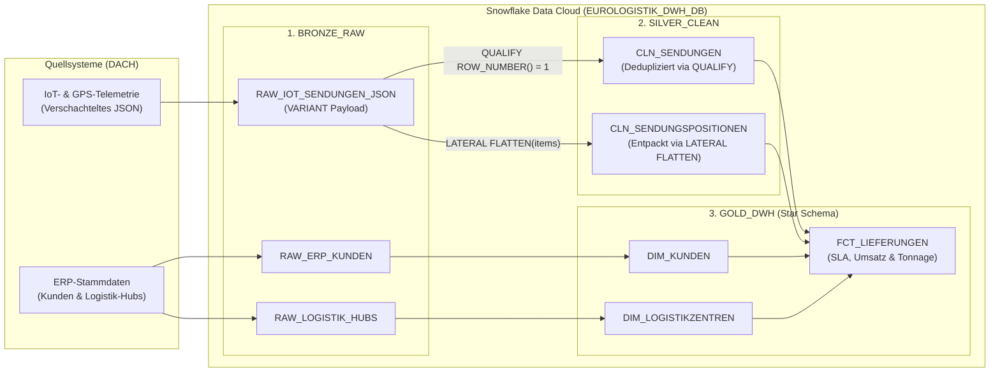
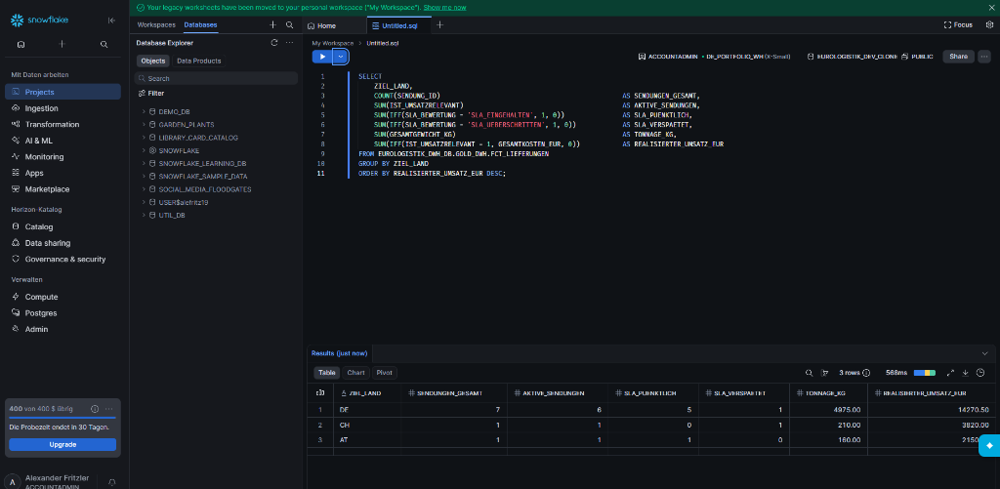
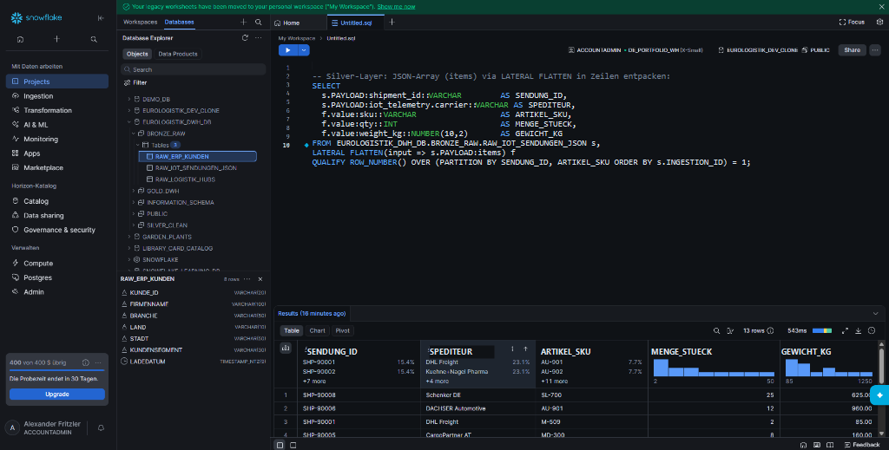
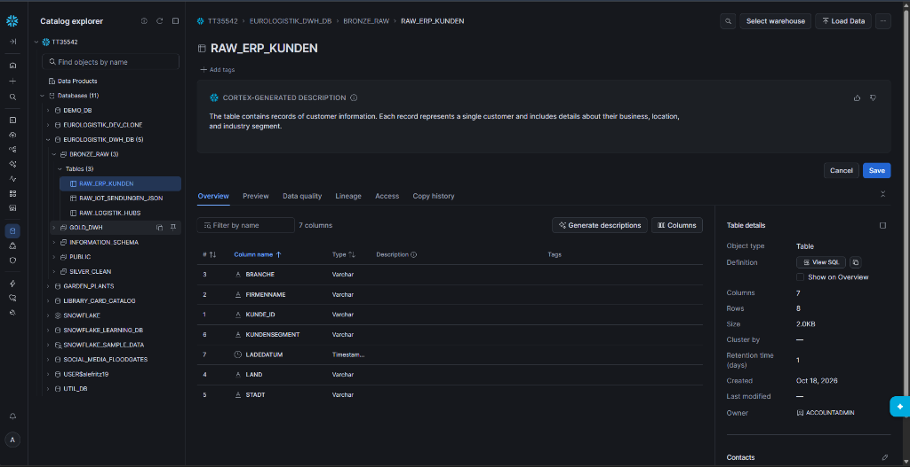

# ❄️ EuroLogistik DACH — Cloud Data Warehouse & Semi-Structured Pipeline on Snowflake
### **End-to-End Medallion Architecture (Bronze ➔ Silver ➔ Gold) · JSON/IoT Processing (`VARIANT` & `LATERAL FLATTEN`) · Kimball Star Schema · Zero-Copy Cloning & Time Travel**

[-29B5E8?style=for-the-badge&logo=snowflake&logoColor=white)](https://achieve.snowflake.com/39919e7c-4de3-46d3-80a5-de041ca1ffc5)
[-0078D4?style=for-the-badge)](#1-architektur--datenfluss-medallion-modell)
[](./sql/01_EuroLogistik_Medallion_Pipeline.sql)
[](#4-produktions-nachweise--snowflake-screenshots)

---

## 📋 Executive Summary & Business Case

Dieses Data-Engineering-Projekt implementiert eine produktionsreife **Cloud-Data-Warehouse-Plattform auf Snowflake** für ein logistisches B2B-Netzwerk in der **DACH-Region (Deutschland, Österreich, Schweiz)**. 

Ziel der Architektur ist die automatisierte Zusammenführung klassischer **relationaler ERP-Stammdaten** (Kunden, Logistikzentren/Hubs) mit **halbstrukturierten IoT- und Sendungs-Telemetriedaten im JSON-Format** (Temperaturüberwachung für Pharmatransporte, Erschütterungssensorik, mehrteilige Packlisten und SLA-Laufzeiten).

### 🛠️ Zentrale Engineering-Lösungen:
* **Hybride Ingestion (`BRONZE_RAW`):** Speicherung relationaler ERP-Tabellen neben tief verschachtelten JSON-Dokumenten im nativen Snowflake-Datentyp `VARIANT` (`PARSE_JSON`).
* **In-Flight Deduplizierung & Array-Entpackung (`SILVER_CLEAN`):** Eliminierung mehrfach gesendeter Sensor-Events mittels `QUALIFY ROW_NUMBER() OVER (...) = 1` sowie Aufbrechen verschachtelter Positions-Arrays (`items`) in relationale Zeilen über `LATERAL FLATTEN`.
* **Dimensional Modeling nach Kimball (`GOLD_DWH`):** Aufbau eines analytischen Sternschemas (`DIM_KUNDEN`, `DIM_LOGISTIKZENTREN`, `FCT_LIEFERUNGEN`) inklusive automatischer SLA-Laufzeitbewertung (`SLA_EINGEHALTEN` vs. `SLA_UEBERSCHRITTEN`) und Storno-Isolierung (`IST_UMSATZRELEVANT`).
* **Snowflake Enterprise Governance:** Einsatz von **Zero-Copy Cloning** (`CREATE DATABASE ... CLONE`) für speicherneutrale Entwicklungs-Umgebungen sowie **Time Travel** (`UNDROP TABLE`) zur verzögerungsfreien Disaster-Recovery.

---

## 1. Architektur & Datenfluss (Medallion-Modell)



---

## 2. Technische Implementierung im Detail

### 2.1 Compute-Isolierung & Auto-Suspend (`DE_PORTFOLIO_WH`)
Zur strikten Kostenkontrolle nutzt die Pipeline ein dediziertes Virtual Warehouse mit automatischer Abschaltung nach 60 Sekunden Inaktivität:
```sql
CREATE OR REPLACE WAREHOUSE DE_PORTFOLIO_WH
    WITH WAREHOUSE_SIZE = 'XSMALL'
    AUTO_SUSPEND = 60
    AUTO_RESUME = TRUE
    INITIALLY_SUSPENDED = FALSE;
```

### 2.2 Silver-Layer: JSON-Parsing & Deduplizierung (`QUALIFY`)
Mehrfach übertragene IoT-Nachrichten (z. B. `SHP-90001`) werden ohne komplexe CTE-Verschachtelung direkt über die Snowflake-Klausel `QUALIFY` bereinigt:
```sql
CREATE OR REPLACE TABLE SILVER_CLEAN.CLN_SENDUNGEN AS
SELECT
    PAYLOAD:shipment_id::VARCHAR(20)                AS SENDUNG_ID,
    PAYLOAD:customer_id::VARCHAR(20)                AS KUNDE_ID,
    PAYLOAD:origin_hub::VARCHAR(10)                 AS HUB_ID,
    PAYLOAD:ship_date::DATE                         AS VERSANDDATUM,
    PAYLOAD:delivery_date::DATE                     AS LIEFERDATUM,
    PAYLOAD:sla_days::INT                           AS SLA_SOLL_TAGE,
    PAYLOAD:status::VARCHAR(30)                     AS SENDUNGSSTATUS,
    PAYLOAD:freight_eur::NUMBER(12,2)               AS FRACHTKOSTEN_EUR,
    PAYLOAD:customs_eur::NUMBER(12,2)               AS ZOLLKOSTEN_EUR,
    PAYLOAD:iot_telemetry.carrier::VARCHAR(50)      AS SPEDITEUR,
    PAYLOAD:iot_telemetry.temp_celsius::NUMBER(5,1) AS IOT_TEMPERATUR_C,
    PAYLOAD:iot_telemetry.shock_g::NUMBER(4,2)      AS IOT_ERSCHUETTERUNG_G,
    INGESTED_AT                                     AS BRONZE_LADEDATUM
FROM BRONZE_RAW.RAW_IOT_SENDUNGEN_JSON
QUALIFY ROW_NUMBER() OVER (
    PARTITION BY PAYLOAD:shipment_id::VARCHAR 
    ORDER BY INGESTION_ID ASC
) = 1;
```

### 2.3 Silver-Layer: Array-Normalisierung mit `LATERAL FLATTEN`
Jedes JSON-Sendungsobjekt enthält ein Array `items` mit beliebig vielen Packstücken (`sku`, `qty`, `weight_kg`). `LATERAL FLATTEN` überführt dieses Array in eine sauber normalisierte Positionstabelle (13 eindeutige Artikelpositionen):
```sql
CREATE OR REPLACE TABLE SILVER_CLEAN.CLN_SENDUNGSPOSITIONEN AS
SELECT
    s.PAYLOAD:shipment_id::VARCHAR(20) AS SENDUNG_ID,
    f.value:sku::VARCHAR(20)           AS ARTIKEL_SKU,
    f.value:qty::INT                   AS MENGE_STUECK,
    f.value:weight_kg::NUMBER(10,2)    AS GEWICHT_KG
FROM (
    SELECT PAYLOAD
    FROM BRONZE_RAW.RAW_IOT_SENDUNGEN_JSON
    QUALIFY ROW_NUMBER() OVER (PARTITION BY PAYLOAD:shipment_id::VARCHAR ORDER BY INGESTION_ID ASC) = 1
) s,
LATERAL FLATTEN(input => s.PAYLOAD:items) f;
```

---

## 3. Validierte Gold-Layer Ergebnisse (DACH Management Report)

Die abschließende Aggregation über die Faktentabelle `GOLD_DWH.FCT_LIEFERUNGEN` isoliert stornierte Sendungen (`IST_UMSATZRELEVANT = 1`) und weist die Logistik-KPIs nach Zielland aus:

| ZIEL_LAND | SENDUNGEN_GESAMT | AKTIVE_SENDUNGEN | SLA_PUENKTLICH | SLA_VERSPAETET | TONNAGE_KG | REALISIERTER_UMSATZ_EUR |
| :--- | :---: | :---: | :---: | :---: | :---: | :---: |
| **DE (Deutschland)** | 7 | 6 | 5 | 1 | 4.975,00 kg | **14.270,50 €** |
| **CH (Schweiz)** | 1 | 1 | 0 | 1 | 210,00 kg | **3.820,00 €** |
| **AT (Österreich)** | 1 | 1 | 1 | 0 | 160,00 kg | **2.150,00 €** |

---

## 4. Produktions-Nachweise & Snowflake Screenshots

### A) Gold-Layer KPI-Aggregation & Star Schema Validierung


### B) Array-Normalisierung (`LATERAL FLATTEN` — 13 Sendungspositionen)


### C) Snowflake Horizon Catalog Explorer & Cortex-Metadaten (`EUROLOGISTIK_DWH_DB` & `EUROLOGISTIK_DEV_CLONE`)


---

## 📂 Repository-Struktur

```text
EuroLogistik-Snowflake-Medallion-DWH/
├── sql/
│   └── 01_EuroLogistik_Medallion_Pipeline.sql   # Vollständiges End-to-End SQL-Skript (Bronze -> Silver -> Gold)
├── docs/
│   └── SQL_Architektur_und_Trainer.md           # Technische Dokumentation der Snowflake-SQL-Patterns
├── assets/                                      # Verifizierte Snowflake-Ausführungsnachweise
└── README.md                                    # Projektübersicht & Architektur-Dokumentation
```
