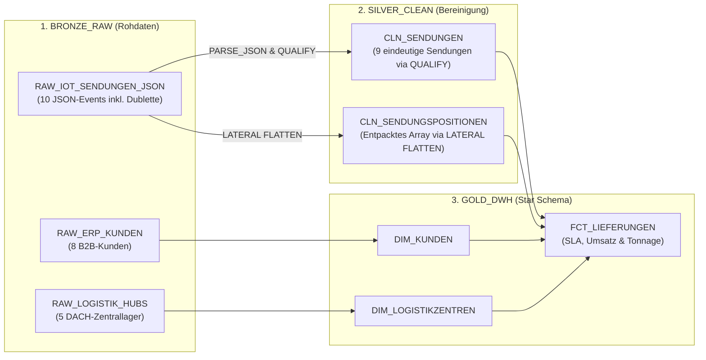

# 🏗️ Portfolio-Projekt 1: EuroLogistik DACH — Cloud DWH & JSON Pipeline (Bronze ➔ Silver ➔ Gold)
## Schritt-für-Schritt Architektur-Erklärung & SQL-Trainer für Snowflake

> **Ziel dieses Dokuments:** Jede einzelne SQL-Zeile des Projekts [`Projekt_01_EuroLogistik_Medallion_DWH.sql`](./Projekt_01_EuroLogistik_Medallion_DWH.sql) verstehen, selbstständig nachbauen und für technische Interviews beherrschen.

---

## 1. Architektur-Übersicht (Medallion-Modell in Snowflake)



---

## 2. Die 5 wichtigsten Snowflake-SQL-Bausteine zum Selbst-Üben

### Baustein 1: Aus einer JSON-Spalte (`VARIANT`) normale Spalten lesen
In Snowflake liegt JSON in einer Spalte vom Typ `VARIANT` (bei uns heißt die Spalte `PAYLOAD`).
* Mit dem **Doppelpunkt `:`** greifst du auf ein JSON-Feld zu: `PAYLOAD:shipment_id`
* Mit dem **Pfeil-Operator `::`** wandelst du den Datentyp um: `::VARCHAR(20)` oder `::DATE` oder `::NUMBER(12,2)`
* Bei **verschachtelten Objekten** (`iot_telemetry`) nutzt du einen Punkt `.` dahinter: `PAYLOAD:iot_telemetry.carrier::VARCHAR(50)`

**Übungsabfrage (Kopiere nur diese 6 Zeilen in dein Worksheet und führe sie einzeln aus):**
```sql
SELECT
    PAYLOAD:shipment_id::VARCHAR(20)           AS SENDUNG_ID,
    PAYLOAD:freight_eur::NUMBER(12,2)          AS FRACHT_EUR,
    PAYLOAD:iot_telemetry.carrier::VARCHAR(50) AS SPEDITEUR
FROM EUROLOGISTIK_DWH_DB.BRONZE_RAW.RAW_IOT_SENDUNGEN_JSON;
```

---

### Baustein 2: Dubletten in einer einzigen Zeile entfernen (`QUALIFY ROW_NUMBER()`)
In klassischen Datenbanken (wie SQL Server) braucht man für `ROW_NUMBER()` immer eine extra CTE (`WITH ...`).
Snowflake besitzt das Spezial-Schlüsselwort **`QUALIFY`** — es filtert Fensterfunktionen direkt ohne Unterabfrage!

**Übungsabfrage:**
```sql
SELECT
    INGESTION_ID,
    PAYLOAD:shipment_id::VARCHAR(20) AS SENDUNG_ID
FROM EUROLOGISTIK_DWH_DB.BRONZE_RAW.RAW_IOT_SENDUNGEN_JSON
QUALIFY ROW_NUMBER() OVER (
    PARTITION BY PAYLOAD:shipment_id::VARCHAR 
    ORDER BY INGESTION_ID ASC
) = 1;
```
*Ergebnis:* Aus 10 Zeilen (wo `SHP-90001` doppelt war) bleiben sofort **9 saubere Zeilen** übrig!

---

### Baustein 3: Listen (`Arrays`) im JSON in Zeilen aufbrechen (`LATERAL FLATTEN`)
Wenn in einer Bestellung mehrere Artikel stecken (`"items": [{"sku":"M-501", ...}, {"sku":"M-509", ...}]`), macht **`LATERAL FLATTEN(input => s.PAYLOAD:items)`** aus jedem Element der Liste eine eigene Tabellenzeile:

```sql
SELECT
    s.PAYLOAD:shipment_id::VARCHAR(20) AS SENDUNG_ID,
    f.value:sku::VARCHAR(20)           AS ARTIKEL_SKU,
    f.value:qty::INT                   AS MENGE_STUECK,
    f.value:weight_kg::NUMBER(10,2)    AS GEWICHT_KG
FROM EUROLOGISTIK_DWH_DB.BRONZE_RAW.RAW_IOT_SENDUNGEN_JSON s,
LATERAL FLATTEN(input => s.PAYLOAD:items) f;
```

---

### Baustein 4: Tabellen zusammenführen (`JOIN`) im Gold-Layer (Star Schema)
Warum machen wir im Gold-Layer einen `JOIN`?
* In der Sendungstabelle (`CLN_SENDUNGEN`) steht nur das Kürzel `KUNDE_ID = 'K-1001'` und `HUB_ID = 'HUB-MUC'`.
* In der Kundentabelle (`DIM_KUNDEN`) steht der echte Firmenname (`AlpenTech Maschinenbau GmbH`) und das Land (`DE`).
* Über `JOIN GOLD_DWH.DIM_KUNDEN k ON s.KUNDE_ID = k.KUNDE_ID` verbinden wir beide Tabellen anhand der Kundennummer.

---

### Baustein 5: Zero-Copy Cloning & Time Travel
1. **`CREATE OR REPLACE DATABASE EUROLOGISTIK_DEV_CLONE CLONE EUROLOGISTIK_DWH_DB;`**
   Erstellt in 1 Sekunde eine komplette Test-Datenbank, ohne die Daten physisch doppelt zu speichern (0 € Zusatzkosten).
2. **`UNDROP TABLE GOLD_DWH.FCT_LIEFERUNGEN;`**
   Holt eine versehentlich gelöschte Tabelle sofort aus dem Snowflake Time Travel zurück.

---

## 3. Verifiziertes Endergebnis (Management KPI-Report)

| ZIEL_LAND | SENDUNGEN_GESAMT | AKTIVE_SENDUNGEN | SLA_PUENKTLICH | SLA_VERSPAETET | TONNAGE_KG | REALISIERTER_UMSATZ_EUR |
| :--- | :---: | :---: | :---: | :---: | :---: | :---: |
| **DE** | 7 | 6 | 5 | 1 | 4.975,00 | **14.270,50 €** |
| **CH** | 1 | 1 | 0 | 1 | 210,00 | **3.820,00 €** |
| **AT** | 1 | 1 | 1 | 0 | 160,00 | **2.150,00 €** |
