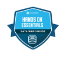

<div align="center">

# 👋 Hi, I'm Alexander Fritzler!
### ⚙️ Cloud Data Engineer & Analytics Engineer (Microsoft Fabric · Snowflake · SQL Server · PySpark)

[](https://www.linkedin.com/in/alexander-fritzler-214628356/)
[](https://achieve.snowflake.com/39919e7c-4de3-46d3-80a5-de041ca1ffc5)
[](mailto:alefritz19@gmail.com)
[](https://maps.google.com)

<p align="center">
  
</p>

</div>

---

## 🏗️ Data Engineering & Cloud Architecture Portfolio

Mein Schwerpunkt liegt auf dem Aufbau robuster, skalierbarer **End-to-End Datenplattformen** — von der Rohdaten-Ingestion und Bereinigung über die **Medallion-Architektur (Bronze ➔ Silver ➔ Gold)** bis hin zur Bereitstellung im analytischen **Gold- & Semantic-Layer**:

```text
[OLTP / ERP / Cloud Stages] ──▶ [Ingestion & CDC (Fabric / Snowflake)] ──▶ [Gold DWH & Star Schema (SQL / PySpark)] ──▶ [Semantic Serving Layer]
```

---

### 1. ⚙️ [Medallion Lakehouse Data Platform on Microsoft Fabric](https://github.com/alefritz19/Supermarkt-Medallion-Lakehouse-Fabric)
> **Cloud Data Engineering & Lakehouse-Architektur (Bronze ➔ Silver ➔ Gold ➔ Direct Lake / DP-700 Standard)**

* **Architekturfokus:** Migration und Skalierung operativer Transaktionsdaten (~755.000 Positionen) in eine moderne SaaS-Lakehouse-Infrastruktur auf Microsoft Fabric.
* **Data Engineering Kernbestandteile:**
  * ⚡ **Bronze ➔ Silver (PySpark ETL Pipelines):** Automatisierte Schemavalidierung, Datentyp-Konvertierung, Bereinigung und Delta-Lake-Speicheroptimierung via `Z-ORDER BY (BonDatum, ProduktID)`.
  * 🏛️ **Gold Layer (Fabric Data Warehouse):** Cross-Database `CTAS`-Aggregationen, dimensionale Views und Stored Procedures für performante Abfragen.
  * 🚀 **Zero-Copy Serving (Direct Lake):** Direkte Anbindung des semantischen Modells an Delta-Parquet-Dateien im OneLake ohne Datenkopien oder Import-Latenzen.
* 🔗 **Repository:** [alefritz19/Supermarkt-Medallion-Lakehouse-Fabric ➔](https://github.com/alefritz19/Supermarkt-Medallion-Lakehouse-Fabric)

---

### 2. 🏛️ [NexusTech B2B ERP Data Platform & SQL Server DWH](https://github.com/alefritz19/NexusTech-B2B-ERP-DataPlatform)
> **End-to-End DWH Engineering: Von 3NF OLTP-Rohdaten zum validierten Kimball-Sternschema**

* **Architekturfokus:** Entwurf und Implementierung einer zentralen Data-Warehouse-Schicht (`dwh`-Schema) auf Microsoft SQL Server für 40.000 B2B-Aufträge (363,82 Mio. € realisierter Nettoumsatz).
* **Data Engineering Kernbestandteile:**
  * 🛠️ **ELT & Daten-Reconciliation:** Zusammenführung normalisierter Belegkopf- und Positionsdaten (`1:n`), Referenzintegritätsprüfung und exakte Festkomma-Typisierung (`DECIMAL(18,2)`).
  * 🛡️ **Status-Flag-Engineering (`IstUmsatzrelevant`):** Technische Isolierung stornierter Aufträge (26,46 Mio. € Abweichungsprävention) ohne Verlust historischer Prozessdaten für Stornoquoten-Analysen.
  * 🔄 **Automatisierte Bereitstellung & Audit:** Rekursive CTE-Kalendergenerierung, kapselnde DWH-Views (`vw_fct_bestellungen`, `vw_dim_produkte`, `vw_dim_kunden`, `vw_dim_vertrieb`), PowerShell-Export-Pipelines sowie 100 % Cent-genaue Abstimmung mittels DAX Studio.
* 🔗 **Repository:** [alefritz19/NexusTech-B2B-ERP-DataPlatform ➔](https://github.com/alefritz19/NexusTech-B2B-ERP-DataPlatform)

---

### 3. 🗄️ [SQL Data Engineering & Production Toolkit](https://github.com/alefritz19/sql-analyst-toolkit)
> **Praxisorientierte T-SQL Referenzarchitektur für Data Cleansing, Deduplizierung & Pipeline-Auditing**

* **Architekturfokus:** Standardisierte SQL-Patterns zur Transformation und Qualitätsprüfung unstrukturierter Rohdaten vor der Übernahme in den Gold-Layer.
* **Data Engineering Kernbestandteile:**
  * 🧹 **Data Cleaning & Deduplication (`DATA_CLEANING_MASTER.sql`):** In-Flight-Bereinigung von String-Artefakten, fehlertolerante Typkonvertierung (`TRY_CONVERT`) und Dubletten-Bereinigung via `ROW_NUMBER() OVER (PARTITION BY ...)`.
  * 📈 **Analytical Window Pipelines (`WINDOW_FUNCTIONS_MASTER.sql`):** Zeitreihen-Offsets via `LAG()`/`LEAD()`, Partition-Rankings (`DENSE_RANK()`) und gleitende Fensteraggregationen (`ROWS BETWEEN 6 PRECEDING`).
  * 🔍 **Segmentierungs- & Kohorten-Logik (`ADVANCED_ANALYTICS_MASTER.sql`):** Skalierbare CTE-Pipelines für mehrstufige Datenklassifizierung (`NTILE`) und Retention-Matrizen.
* 🔗 **Repository:** [alefritz19/sql-analyst-toolkit ➔](https://github.com/alefritz19/sql-analyst-toolkit)

---

### 4. 📊 [Gold-Layer Serving & Kimball Star Schema Architecture](https://github.com/alefritz19/PowerBI-Supermarkt-Analytics)
> **Dimensional Modeling & Semantic Layer Bereitstellung (6 Dimensionen · 2 Faktentabellen)**

* **Architekturfokus:** Bereitstellung einer hochperformanten Gold-Layer-Datenarchitektur nach Ralph Kimball als Schnittstelle zwischen Data Warehouse und Fachbereich.
* **Kernbestandteile:**
  * ⭐ **Strikte Sternschema-Modellierung:** Saubere Trennung von Fakten (`fct_verkaeufe`, `fct_abschreibungen`) und Dimensionen (`dim_produkt`, `dim_kunde`, `dim_filiale`, `dim_datum`, `dim_mitarbeiter`, `dim_aktionen`) mit `1:n`-Kardinalität.
  * ⚡ **Power Query (M) & VertiPaq-Optimierung:** Vorgelagerte Transformationen und speichereffiziente Spaltenmodellierung für schnelle Abfragezeiten auf ~755.000 Transaktionszeilen.
* 🔗 **Repository:** [alefritz19/PowerBI-Supermarkt-Analytics ➔](https://github.com/alefritz19/PowerBI-Supermarkt-Analytics)

---

## 🏅 Offizielle Cloud-Zertifizierungen & Verified Badges

<table>
  <tr>
    <td align="center" width="140">
      <a href="https://achieve.snowflake.com/39919e7c-4de3-46d3-80a5-de041ca1ffc5">
        
      </a>
    </td>
    <td>
      <b>❄️ Snowflake Hands-On Essentials: Data Warehousing Workshop</b><br/>
      <i>Ausgestellt von Snowflake Inc. (Offiziell verifiziert über Accredible / DORA)</i><br/>
      <ul>
        <li><b>Schwerpunkte:</b> Multi-Cluster Shared Data Architecture, Virtual Warehouses, Stages (Internal & AWS S3 External), File Formats (CSV, TSV, JSON, XML), Semi-Structured Data Parsing (<code>VARIANT</code>, <code>LATERAL FLATTEN</code>), 3NF & Dimensional Modeling.</li>
        <li>🔗 <b>Offizieller Zertifikatsnachweis:</b> <a href="https://achieve.snowflake.com/39919e7c-4de3-46d3-80a5-de041ca1ffc5">achieve.snowflake.com/39919e7c-4de3-46d3-80a5-de041ca1ffc5 ➔</a></li>
      </ul>
    </td>
  </tr>
</table>

---

## 🛠️ Tech Stack & Data Engineering Kompetenzen

<table>
  <tr>
    <td align="center" width="96">
      
      <br><b>MS Fabric</b>
    </td>
    <td align="center" width="96">
      
      <br><b>Snowflake</b>
    </td>
    <td align="center" width="96">
      
      <br><b>SQL Server</b>
    </td>
    <td align="center" width="96">
      
      <br><b>PySpark</b>
    </td>
    <td align="center" width="96">
      
      <br><b>Python</b>
    </td>
    <td align="center" width="96">
      
      <br><b>Git CLI</b>
    </td>
    <td align="center" width="96">
      
      <br><b>Gold Layer</b>
    </td>
  </tr>
</table>

* **☁️ Cloud Data Platforms & Lakehouse:** Microsoft Fabric (OneLake, Lakehouse, Data Warehouse, PySpark Notebooks, Direct Lake, DP-700) · **Snowflake Data Cloud** (Virtual Warehouses, Stages, Snowpipe, Streams/CDC, Tasks, Dynamic Tables, Time Travel, Zero-Copy Cloning) · Delta Lake & Parquet
* **🏛️ Data Warehousing & SQL Engineering:** Microsoft SQL Server · Kimball Dimensional Modeling (Star Schema) · Medallion-Architektur (Bronze / Silver / Gold) · T-SQL & Snowflake SQL · CTE-Pipelines · Window Functions · Referenzintegrität & Reconciliation
* **⚙️ ETL/ELT Automation & Tooling:** Python · PySpark · PowerShell Data Pipelines · Git & GitHub CLI · VS Code
* **📊 Semantic Serving Layer (Zusatzkompetenz):** Bereitstellung und Validierung von Gold-Layer-Modellen via DAX Studio & Power BI (Star Schema Relationships, VertiPaq Performance Auditing)

---

<div align="center">
  <i>"Robuste Datenarchitekturen und saubere Pipelines sind das Fundament jeder datengetriebenen Entscheidung."</i>
</div>