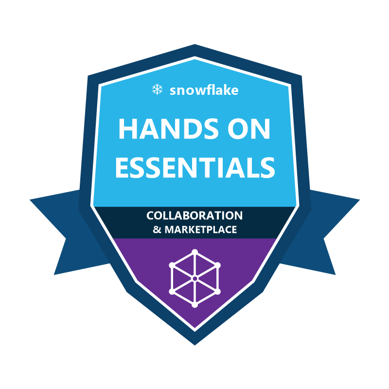

<div align="center">

# 👋 Hallo, ich bin Alexander Fritzler!
### ⚙️ Junior Data Engineer (Microsoft Fabric · Snowflake · SQL Server · PySpark)

[](https://www.linkedin.com/in/alexander-fritzler-214628356/)
[](https://achieve.snowflake.com/39919e7c-4de3-46d3-80a5-de041ca1ffc5)
[](https://achieve.snowflake.com/08fa3f9a-ca45-4ae0-9bb0-d869233af4ff#acc.sX9QkHTd)
[](mailto:alefritz19@gmail.com)
[](https://maps.google.com)

<p align="center">
  
</p>

</div>

---

## 🏅 Weiterbildung: Snowflake Hands-On Essentials (Workshop-Badges)

<table>
  <tr>
    <td align="center" width="140">
      <a href="https://achieve.snowflake.com/39919e7c-4de3-46d3-80a5-de041ca1ffc5">
        
      </a>
    </td>
    <td>
      <b>❄️ Snowflake Hands-On Essentials: Data Warehousing Workshop</b><br/>
      <i>Workshop-Badge von Snowflake Inc. (praktische Aufgaben automatisch geprüft über DORA)</i><br/>
      <ul>
        <li><b>Schwerpunkte:</b> Multi-Cluster-Shared-Data-Architektur, Virtual Warehouses, Stages (intern & extern über AWS S3), Dateiformate (CSV, TSV, JSON, XML), Verarbeitung semistrukturierter Daten (<code>VARIANT</code>, <code>LATERAL FLATTEN</code>), 3NF & dimensionale Modellierung.</li>
        <li>🔗 <b>Badge-Nachweis:</b> <a href="https://achieve.snowflake.com/39919e7c-4de3-46d3-80a5-de041ca1ffc5">achieve.snowflake.com/39919e7c-4de3-46d3-80a5-de041ca1ffc5 ➔</a></li>
      </ul>
    </td>
  </tr>
  <tr>
    <td align="center" width="140">
      <a href="https://achieve.snowflake.com/08fa3f9a-ca45-4ae0-9bb0-d869233af4ff#acc.sX9QkHTd">
        
      </a>
    </td>
    <td>
      <b>❄️ Snowflake Hands-On Essentials: Collaboration, Marketplace & Cost Estimation Workshop</b><br/>
      <i>Workshop-Badge von Snowflake Inc. (praktische Aufgaben automatisch geprüft über DORA)</i><br/>
      <ul>
        <li><b>Schwerpunkte:</b> Multi-Cloud-Infrastruktur (AWS Frankfurt, GCP US-Central1, Azure West US 2), Secure Data Sharing (cloud- und kontoübergreifend ohne Datenkopie), Snowflake Marketplace (Listings anbieten & nutzen), Secure User-Defined Table Functions (UDTFs), FinOps & Kostenüberwachung (gestaffelte Credit-Warnungen & Resource Monitors).</li>
        <li>🔗 <b>Badge-Nachweis:</b> <a href="https://achieve.snowflake.com/08fa3f9a-ca45-4ae0-9bb0-d869233af4ff#acc.sX9QkHTd">achieve.snowflake.com/08fa3f9a-ca45-4ae0-9bb0-d869233af4ff#acc.sX9QkHTd ➔</a></li>
      </ul>
    </td>
  </tr>
</table>

> 💼 **Übersicht aller Snowflake-Badges:** [achieve.snowflake.com/profile/alexanderfritzler918558/wallet](https://achieve.snowflake.com/profile/alexanderfritzler918558/wallet)

---

## 🏗️ Data-Engineering-Portfolio

Mein Schwerpunkt liegt auf dem Aufbau robuster, skalierbarer **End-to-End-Datenplattformen** — von der Rohdaten-Ingestion und Bereinigung über die **Medallion-Architektur (Bronze ➔ Silver ➔ Gold)** bis hin zur Bereitstellung im analytischen **Gold Layer & Semantic Layer**:

```text
[OLTP / ERP / Cloud Stages] ──▶ [Ingestion & CDC (Fabric / Snowflake)] ──▶ [Gold-DWH & Sternschema (SQL / PySpark)] ──▶ [Semantic Layer]
```

---

### 1. ❄️ [EuroLogistik DACH — Cloud-DWH & Pipeline für semistrukturierte Daten auf Snowflake](https://github.com/alefritz19/EuroLogistik-Snowflake-Medallion-DWH)
> **Snowflake: Medallion-Architektur (Bronze ➔ Silver ➔ Gold) · JSON-/IoT-Verarbeitung (`VARIANT` & `LATERAL FLATTEN`) · Kimball-Sternschema · Zero-Copy Cloning & Time Travel**

* **Architekturfokus:** Aufbau einer dreischichtigen Cloud-Data-Warehouse-Plattform (`EUROLOGISTIK_DWH_DB`) für B2B-Logistik- und IoT-Sendungsdaten in der DACH-Region (Deutschland, Österreich, Schweiz).
* **Kernbestandteile:**
  * 📦 **Bronze ➔ Silver (`VARIANT`, `LATERAL FLATTEN` & `QUALIFY`):** Hybride Ingestion relationaler ERP-Stammdaten und verschachtelter JSON-Telemetrieevents, Deduplizierung beim Laden via `QUALIFY ROW_NUMBER() OVER (...) = 1` sowie Normalisierung mehrteiliger Positions-Arrays in relationale Tabellen.
  * ⭐ **Gold Layer (Kimball-Sternschema):** Modellierung der Dimensionen (`DIM_KUNDEN`, `DIM_LOGISTIKZENTREN`) und der Faktentabelle (`FCT_LIEFERUNGEN`) inklusive automatischer SLA-Laufzeitbewertung und Storno-Isolierung (`IST_UMSATZRELEVANT`).
  * 🛡️ **Snowflake-Funktionen:** Speicherkostenfreies **Zero-Copy Cloning** (`EUROLOGISTIK_DEV_CLONE`) für Testumgebungen sowie sofortige Tabellenwiederherstellung via **Time Travel** (`UNDROP TABLE`).
* 🔗 **Repository:** [alefritz19/EuroLogistik-Snowflake-Medallion-DWH ➔](https://github.com/alefritz19/EuroLogistik-Snowflake-Medallion-DWH)

---

### 2. ⚙️ [Medallion-Lakehouse-Datenplattform auf Microsoft Fabric](https://github.com/alefritz19/Supermarkt-Medallion-Lakehouse-Fabric)
> **Cloud Data Engineering & Lakehouse-Architektur (Bronze ➔ Silver ➔ Gold ➔ Direct Lake / DP-700)**

* **Architekturfokus:** Migration und Skalierung operativer Transaktionsdaten (~755.000 Positionen) in eine moderne SaaS-Lakehouse-Infrastruktur auf Microsoft Fabric.
* **Kernbestandteile:**
  * ⚡ **Bronze ➔ Silver (PySpark-ETL-Pipelines):** Automatisierte Schemavalidierung, Datentyp-Konvertierung, Bereinigung und Delta-Lake-Speicheroptimierung via `Z-ORDER BY (BonDatum, ProduktID)`.
  * 🏛️ **Gold Layer (Fabric Data Warehouse):** Datenbankübergreifende `CTAS`-Aggregationen, dimensionale Views und Stored Procedures für performante Abfragen.
  * 🚀 **Bereitstellung ohne Datenkopie (Direct Lake):** Direkte Anbindung des semantischen Modells an Delta-Parquet-Dateien im OneLake ohne Datenkopien oder Import-Latenzen.
* 🔗 **Repository:** [alefritz19/Supermarkt-Medallion-Lakehouse-Fabric ➔](https://github.com/alefritz19/Supermarkt-Medallion-Lakehouse-Fabric)

---

### 3. 🏛️ [NexusTech B2B-ERP-Datenplattform & SQL-Server-DWH](https://github.com/alefritz19/NexusTech-B2B-ERP-DataPlatform)
> **End-to-End-DWH: Von 3NF-OLTP-Rohdaten zum validierten Kimball-Sternschema**

* **Architekturfokus:** Entwurf und Implementierung einer zentralen Data-Warehouse-Schicht (`dwh`-Schema) auf Microsoft SQL Server für 40.000 B2B-Aufträge (363,82 Mio. € realisierter Nettoumsatz).
* **Kernbestandteile:**
  * 🛠️ **ELT & Datenabstimmung:** Zusammenführung normalisierter Belegkopf- und Positionsdaten (`1:n`), Referenzintegritätsprüfung und exakte Festkomma-Typisierung (`DECIMAL(18,2)`).
  * 🛡️ **Status-Flag-Logik (`IstUmsatzrelevant`):** Technische Isolierung stornierter Aufträge (26,46 Mio. € Abweichungsprävention) ohne Verlust historischer Prozessdaten für Stornoquoten-Analysen.
  * 🔄 **Automatisierte Bereitstellung & Prüfung:** Rekursive CTE-Kalendergenerierung, kapselnde DWH-Views (`vw_fct_bestellungen`, `vw_dim_produkte`, `vw_dim_kunden`, `vw_dim_vertrieb`), PowerShell-Export-Pipelines sowie centgenaue Abstimmung (100 %) mittels DAX Studio.
* 🔗 **Repository:** [alefritz19/NexusTech-B2B-ERP-DataPlatform ➔](https://github.com/alefritz19/NexusTech-B2B-ERP-DataPlatform)

---

### 4. 🗄️ [SQL-Toolkit für Datenbereinigung & Analyse](https://github.com/alefritz19/sql-analyst-toolkit)
> **Praxisorientierte T-SQL-Muster für Datenbereinigung, Deduplizierung & Pipeline-Prüfung**

* **Architekturfokus:** Standardisierte SQL-Muster zur Transformation und Qualitätsprüfung unstrukturierter Rohdaten vor der Übernahme in den Gold Layer.
* **Kernbestandteile:**
  * 🧹 **Datenbereinigung & Deduplizierung (`DATA_CLEANING_MASTER.sql`):** Bereinigung von String-Artefakten beim Laden, fehlertolerante Typkonvertierung (`TRY_CONVERT`) und Dubletten-Bereinigung via `ROW_NUMBER() OVER (PARTITION BY ...)`.
  * 📈 **Analytische Fensterfunktionen (`WINDOW_FUNCTIONS_MASTER.sql`):** Zeitreihen-Offsets via `LAG()`/`LEAD()`, Rankings je Partition (`DENSE_RANK()`) und gleitende Fensteraggregationen (`ROWS BETWEEN 6 PRECEDING`).
  * 🔍 **Segmentierungs- & Kohorten-Logik (`ADVANCED_ANALYTICS_MASTER.sql`):** Skalierbare CTE-Pipelines für mehrstufige Datenklassifizierung (`NTILE`) und Retention-Matrizen.
* 🔗 **Repository:** [alefritz19/sql-analyst-toolkit ➔](https://github.com/alefritz19/sql-analyst-toolkit)

---

### 5. 📊 [Gold Layer & Kimball-Sternschema für Power BI](https://github.com/alefritz19/PowerBI-Supermarkt-Analytics)
> **Dimensionale Modellierung & Bereitstellung des Semantic Layer (6 Dimensionen · 2 Faktentabellen)**

* **Architekturfokus:** Bereitstellung einer performanten Gold-Layer-Datenarchitektur nach Ralph Kimball als Schnittstelle zwischen Data Warehouse und Fachbereich.
* **Kernbestandteile:**
  * ⭐ **Strikte Sternschema-Modellierung:** Saubere Trennung von Fakten (`fct_verkaeufe`, `fct_abschreibungen`) und Dimensionen (`dim_produkt`, `dim_kunde`, `dim_filiale`, `dim_datum`, `dim_mitarbeiter`, `dim_aktionen`) mit `1:n`-Kardinalität.
  * ⚡ **Power Query (M) & VertiPaq-Optimierung:** Vorgelagerte Transformationen und speichereffiziente Spaltenmodellierung für schnelle Abfragezeiten auf ~755.000 Transaktionszeilen.
* 🔗 **Repository:** [alefritz19/PowerBI-Supermarkt-Analytics ➔](https://github.com/alefritz19/PowerBI-Supermarkt-Analytics)

---

## 🛠️ Technologien & Kompetenzen

<table>
  <tr>
    <td align="center" width="96">
      
      <br><b>MS Fabric</b>
    </td>
    <td align="center" width="96">
      
      <br><b>Snowflake</b>
    </td>
    <td align="center" width="96">
      
      <br><b>SQL Server</b>
    </td>
    <td align="center" width="96">
      
      <br><b>PySpark</b>
    </td>
    <td align="center" width="96">
      
      <br><b>Python</b>
    </td>
    <td align="center" width="96">
      
      <br><b>Git</b>
    </td>
    <td align="center" width="96">
      
      <br><b>Gold Layer</b>
    </td>
  </tr>
</table>

* **☁️ Cloud-Datenplattformen & Lakehouse:** Microsoft Fabric (OneLake, Lakehouse, Data Warehouse, PySpark Notebooks, Direct Lake, DP-700) · **Snowflake** (Virtual Warehouses, Stages, Snowpipe, Streams/CDC, Tasks, Dynamic Tables, Time Travel, Zero-Copy Cloning) · Delta Lake & Parquet
* **🏛️ Data Warehousing & SQL:** Microsoft SQL Server · Dimensionale Modellierung nach Kimball (Sternschema) · Medallion-Architektur (Bronze / Silver / Gold) · T-SQL & Snowflake SQL · CTE-Pipelines · Fensterfunktionen · Referenzintegrität & Datenabstimmung
* **⚙️ ETL/ELT-Automatisierung & Werkzeuge:** Python · PySpark · PowerShell-Pipelines · Git & GitHub CLI · VS Code
* **📊 Semantic Layer (Zusatzkompetenz):** Bereitstellung und Validierung von Gold-Layer-Modellen mit DAX Studio & Power BI (Sternschema-Beziehungen, VertiPaq-Performance-Analyse)

---

<div align="center">
  <i>"Robuste Datenarchitekturen und saubere Pipelines sind das Fundament jeder datengetriebenen Entscheidung."</i>
</div>
